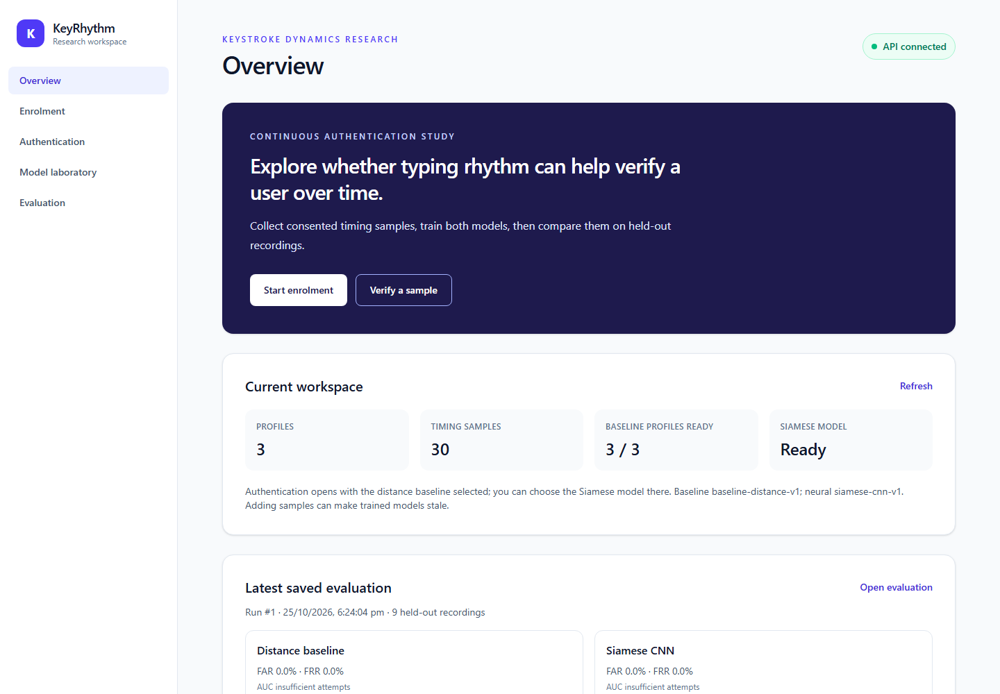
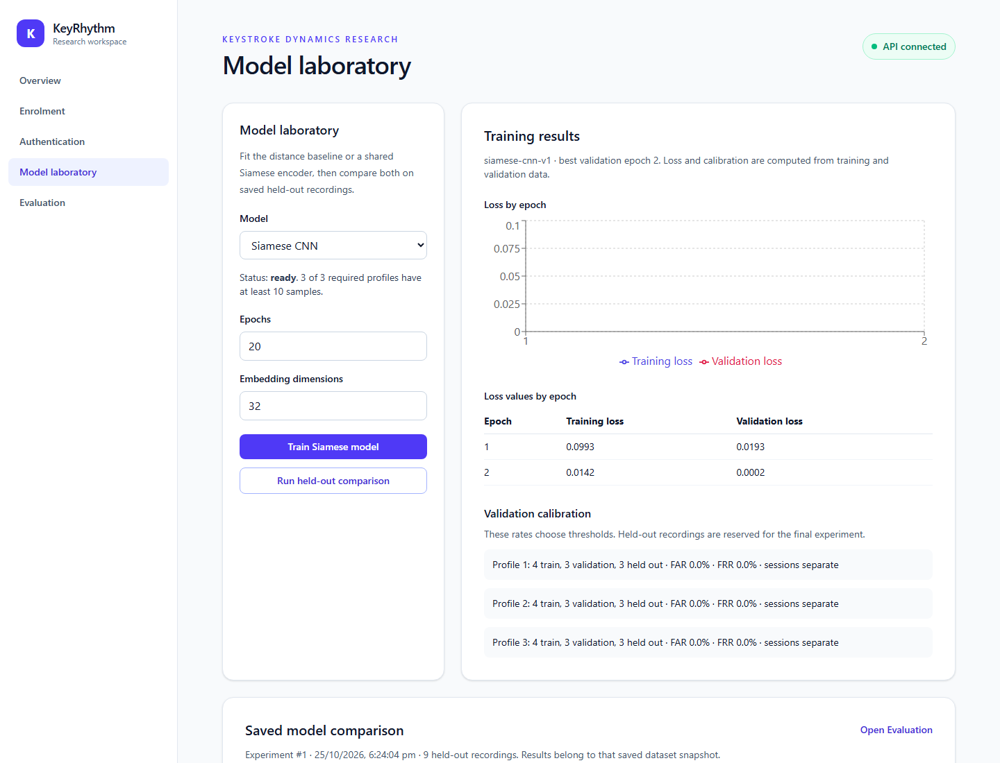
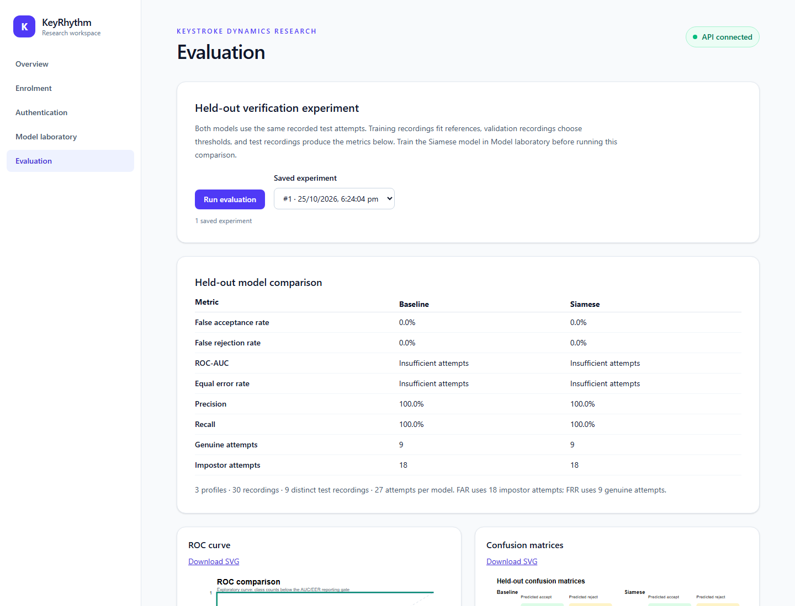

# Milestone 7 demonstration

The supplied walkthrough uses **synthetic timing data** to exercise the software. These records and screenshots are not participant measurements or academic performance evidence. Run commands from the repository root in PowerShell after following the [README install](../README.md#install).

## Start an isolated synthetic walkthrough

The default demo directory must be absent or empty. Use a new path for each rerun; `backend/data/` is ignored by Git.

```powershell
Push-Location backend
..\.venv\Scripts\python.exe -m app.demo_cli --output data\synthetic-demo --epochs 2
$env:KEYRHYTHM_DATABASE_URL = "sqlite:///$((Resolve-Path data\synthetic-demo\keyrhythm.sqlite3).Path.Replace('\','/'))"
$env:KEYRHYTHM_ARTIFACT_DIR = (Resolve-Path data\synthetic-demo\artifacts).Path
..\.venv\Scripts\python.exe -m app.report_cli --experiment-id 1 --output data\synthetic-demo\report
..\.venv\Scripts\python.exe -m uvicorn app.main:app --host 127.0.0.1 --port 8000
```

Leave the backend terminal running. In a second terminal:

```powershell
npm.cmd --prefix frontend run dev
```

Open `http://127.0.0.1:5173/#overview`. The overview should show three profiles, 30 samples, a ready Siamese model, and a saved experiment. Enrolment lists the `SYNTHETIC` profile names. Open `#laboratory` to show training history and model state, then `#evaluation` to show the saved comparison and download plots. The report folder contains `results.md`, CSV tables, and SVG/PNG figures derived from the saved run. This shows the application path from data through training, evaluation, and export. The demo generator creates timing arrays directly; it does **not** simulate a human typing interaction or validate browser capture quality.

## Live capture and deletion checks

For a consented live walkthrough, use a separate default database and the README's local startup commands. Create a pseudonymous profile under **Enrolment**, accept the consent notice, and type the displayed challenge exactly. A new sample increments the count. Select that profile for **Authentication** after enough profiles and recordings are collected and models are trained; a verification request returns a score and decision while retaining only a decision summary. Delete the profile in Enrolment and confirm its samples and summaries disappear. Global neural artifacts and saved experiments are invalidated because they may contain information from the deleted profile. Keep real participant timing and any copied database outside version control.

## Screenshots

Screenshots below were captured from the isolated **synthetic** walkthrough. They show interface state and saved results; their metric values must not be cited as participant results.






